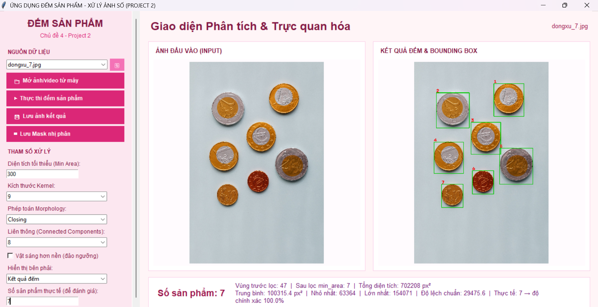
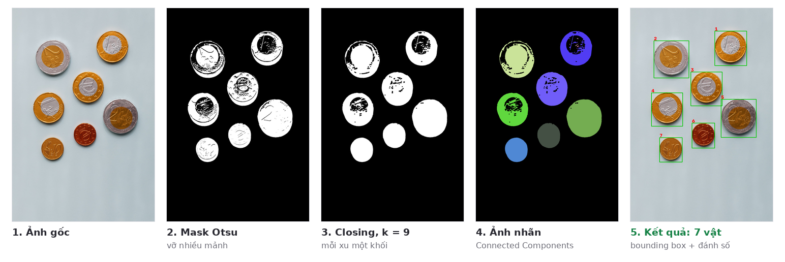
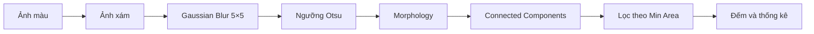
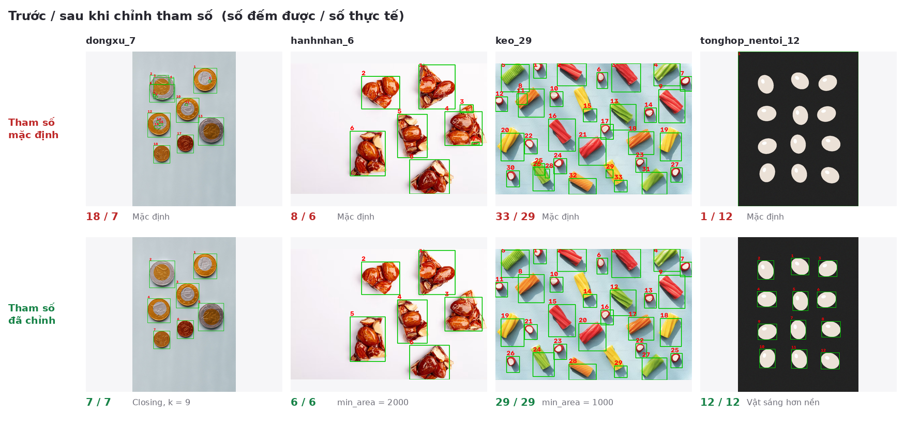
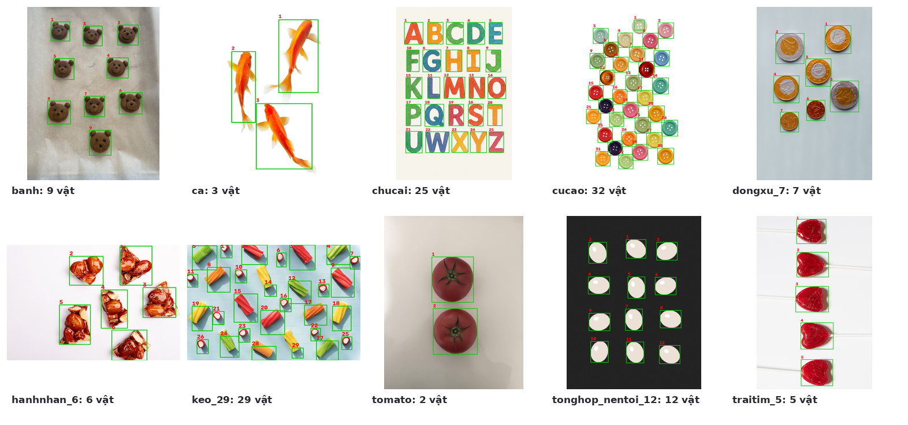

<div align="center">

# Đếm sản phẩm bằng Xử lý ảnh số

**Công cụ đếm vật thể trong ảnh bằng OpenCV, có giao diện để chỉnh tham số và xem từng bước xử lý.**


Đồ án môn **Xử lý ảnh số** · Chủ đề 4, Project 2 · Nhóm 01

[English summary](#english-summary)

</div>





## Giới thiệu

Chương trình nhận một ảnh (hoặc khung hình đầu của video), tách vật thể ra khỏi nền và đếm số lượng. Mỗi vật được đóng khung, đánh số, kèm thống kê diện tích.

Không có một bộ tham số nào chạy đúng cho mọi ảnh. Vật sáng hay tối hơn nền, có hoa văn, có bóng đổ hay có mảnh vụn đều cần cách xử lý khác nhau. Vì vậy nhóm làm chương trình thành một **công cụ**: người dùng chỉnh tham số trên giao diện, xem ngay mask trước và sau từng bước, rồi đánh giá độ chính xác so với số thực tế. Dataset được chọn có chủ đích gồm cả ảnh dễ lẫn ảnh khó để thể hiện điều này.

## Tính năng

- Mở ảnh (`.png`, `.jpg`, `.bmp`, `.tif`) hoặc video (`.mp4`, `.avi`, `.mov`, xử lý khung hình đầu tiên), từ thư mục `dataset/` hoặc từ máy.
- Chỉnh tham số và kết quả tự cập nhật:
  - **Min Area**: diện tích tối thiểu để giữ lại một vùng.
  - **Kernel**: 3, 5, 7, 9.
  - **Phép toán Morphology**: Không, Opening, Closing, Opening + Closing, Erode, Dilate.
  - **Liên thông**: 4 hoặc 8 lân cận.
  - **Vật sáng hơn nền**: đảo chiều ngưỡng Otsu.
- 4 chế độ xem kết quả: kết quả đếm, mask Otsu, mask sau Morphology, ảnh nhãn.
- Thống kê diện tích: tổng, trung bình, nhỏ nhất, lớn nhất, độ lệch chuẩn.
- Nhập số thực tế để tính độ chính xác.
- Lưu ảnh kết quả và mask nhị phân. Đọc và ghi được đường dẫn có dấu tiếng Việt trên Windows.

## Quy trình xử lý



| Bước | Kỹ thuật                           | Mục đích                                                                                                  |
| ---- | ---------------------------------- | --------------------------------------------------------------------------------------------------------- |
| 1    | Chuyển ảnh xám + Gaussian Blur 5×5 | Giảm nhiễu hạt trước khi tìm ngưỡng                                                                       |
| 2    | Ngưỡng Otsu                        | Tự tìm ngưỡng tách vật và nền. `BINARY_INV` cho vật tối trên nền sáng, `BINARY` cho vật sáng trên nền tối |
| 3    | Morphology                         | Opening xóa chấm nhiễu, Closing lấp lỗ và nối các mảnh vỡ của cùng một vật                                |
| 4    | Connected Components               | Gán nhãn từng vùng liên thông (4 hoặc 8 lân cận), lấy diện tích và bounding box                           |
| 5    | Lọc Min Area                       | Bỏ các vùng nhỏ như bụi, bóng, phản sáng                                                                  |
| 6    | Thống kê                           | Số lượng, diện tích và độ chính xác `max(0, 1 − \|N − T\| / T)`                                           |

## Cài đặt và chạy

Yêu cầu Python 3.9 trở lên. Tkinter có sẵn trong bản Python cài từ python.org.

```bash
git clone https://github.com/kimanhtran-oss/product-counting-opencv.git
cd product-counting-opencv
pip install -r requirements.txt

# Mở giao diện
python count_gui.py

# Đánh giá trên toàn bộ dataset, in bảng kết quả
python evaluate.py
python evaluate.py --save results   # lưu thêm ảnh kết quả
```

## Cấu trúc thư mục

```
product-counting-opencv/
├── count_gui.py              # Giao diện Tkinter
├── evaluate.py               # Đánh giá độ chính xác trên dataset
├── modules/
│   └── count.py              # Thuật toán: Otsu, Morphology, Connected Components, thống kê
├── dataset/
│   ├── *.jpg                 # 10 ảnh thử nghiệm
│   └── ground_truth.json     # Số thực tế và bộ tham số đã chỉnh cho từng ảnh
├── images/                   # Ảnh minh họa cho README
├── docs/
│   └── XLA_Nhom01.pdf        # Slide thuyết trình
└── requirements.txt
```

## Kết quả

Bảng dưới được tạo bằng `python evaluate.py`. Cột **Mặc định** dùng tham số mặc định (Min Area 300, kernel 3, Opening + Closing, 8 lân cận, vật tối hơn nền). Cột **Đã chỉnh** dùng tham số lưu trong `dataset/ground_truth.json`.

| Ảnh                     | Thực tế |         Mặc định         |          Đã chỉnh          | Tham số đã chỉnh         |
| ----------------------- | :-----: | :----------------------: | :------------------------: | ------------------------ |
| `banh.jpg`              |    9    |        9 (100.0%)        |         9 (100.0%)         | mặc định                 |
| `ca.jpg`                |    3    |        3 (100.0%)        |         3 (100.0%)         | mặc định                 |
| `chucai.jpg`            |   25    |       25 (100.0%)        |        25 (100.0%)         | mặc định                 |
| `cucao.jpg`             |   32    |        34 (93.8%)        |        32 (100.0%)         | min_area = 1000, Closing |
| `dongxu_7.jpg`          |    7    |        18 (0.0%)         |         7 (100.0%)         | k = 9, Closing           |
| `hanhnhan_6.jpg`        |    6    |        8 (66.7%)         |         6 (100.0%)         | min_area = 2000          |
| `keo_29.jpg`            |   29    |        33 (86.2%)        |        29 (100.0%)         | min_area = 1000          |
| `tomato.jpg`            |    2    |        2 (100.0%)        |         2 (100.0%)         | mặc định                 |
| `tonghop_nentoi_12.jpg` |   12    |         1 (8.3%)         |        12 (100.0%)         | vật sáng hơn nền         |
| `traitim_5.jpg`         |    5    |        5 (100.0%)        |         5 (100.0%)         | mặc định                 |
| **Tổng kết**            |         | **5/10 đúng · TB 75.5%** | **10/10 đúng · TB 100.0%** |                          |



### Vì sao các ảnh khó cần chỉnh tham số

| Ảnh       | Vấn đề với tham số mặc định                                                                                                  | Cách chỉnh                                                 |
| --------- | ---------------------------------------------------------------------------------------------------------------------------- | ---------------------------------------------------------- |
| Đồng xu   | Hoa văn nổi và phần bạc gần màu nền làm mask Otsu vỡ thành nhiều mảnh. Kernel 3 nhỏ hơn khe giữa các mảnh nên không nối được | **Closing, k = 9** lấp khe, mỗi xu thành một khối          |
| Hạnh nhân | Vùng phản sáng và mảnh hạt rời bị đếm thành vật riêng                                                                        | Tăng **Min Area lên 2000** để bỏ mảnh nhỏ                  |
| Kẹo       | Mảnh vụn và đầu kẹo bị tách nhỏ tạo vùng dư                                                                                  | Tăng **Min Area lên 1000**                                 |
| Cúc áo    | Cúc màu nhạt gần màu nền bị tách làm hai                                                                                     | **Closing** nối hai nửa, **Min Area 1000** bỏ mảnh còn sót |
| Nền tối   | Vật sáng trên nền tối, chế độ mặc định coi nền là vật nên cả ảnh thành 1 vùng                                                | Bật **Vật sáng hơn nền** để đảo ngưỡng                     |

### Gợi ý chỉnh tham số

| Hiện tượng                               | Nên chỉnh                                |
| ---------------------------------------- | ---------------------------------------- |
| Một vật bị đếm thành nhiều vật (mask vỡ) | Dùng Closing hoặc tăng kernel            |
| Nhiều chấm nhiễu nhỏ được đếm            | Dùng Opening hoặc tăng Min Area          |
| Hai vật gần nhau bị dính thành một       | Giảm kernel, tránh Dilate, thử 4 lân cận |
| Cả ảnh chỉ ra 1 vùng                     | Đảo chế độ Vật sáng hơn nền              |



## Hạn chế và hướng phát triển

- Hai vật chạm nhau sẽ bị gộp thành một vùng. Có thể dùng Distance Transform kết hợp Watershed để tách.
- Ngưỡng Otsu toàn cục không hợp với ảnh chiếu sáng không đều. Có thể dùng ngưỡng thích nghi.
- Min Area tính bằng pixel nên phụ thuộc độ phân giải ảnh. Có thể tự gợi ý từ phân bố diện tích các vùng.
- Video hiện chỉ xử lý khung hình đầu tiên. Có thể mở rộng để đếm theo từng khung hình.

## Thành viên

| Thành viên        | Phụ trách                     |
| ----------------- | ----------------------------- |
| Trần Thị Kim Anh  | Phần 1: Morphology            |
| Lương Ngô Gia An  | Phần 2: Connected Components  |
| Trần Lý Hoàng Đức | Phần 3: Thống kê và giao diện |

Slide thuyết trình đầy đủ: [docs/XLA_Nhom01.pdf](docs/XLA_Nhom01.pdf)

## Nguồn ảnh

Ảnh trong thư mục `dataset/` được sưu tầm từ Internet (Unsplash, Pinterest...) và chỉ dùng cho mục đích học tập. Bản quyền thuộc về tác giả gốc.

## English summary

A product-counting tool built with **Python, OpenCV and Tkinter** for a Digital Image Processing course project. Pipeline: grayscale → Gaussian blur → Otsu thresholding → morphological opening/closing → connected-component labeling → area filtering → statistics.

Since no single parameter set fits every image, the app is designed as an interactive tool. Users tune the minimum area, kernel size, morphology operation, connectivity and threshold polarity, and inspect the intermediate masks live. On the 10-image dataset (chosen to include hard cases such as embossed coins, shadows and bright-on-dark objects), default parameters count 5/10 images correctly (75.5% mean accuracy). Tuned parameters reach 10/10 (100%). Run `python evaluate.py` to reproduce the results.

## License

Phát hành theo giấy phép [MIT](LICENSE).
